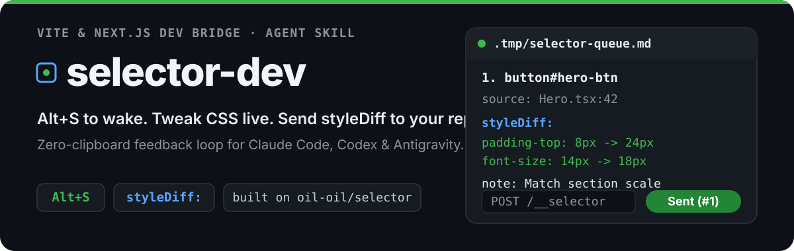
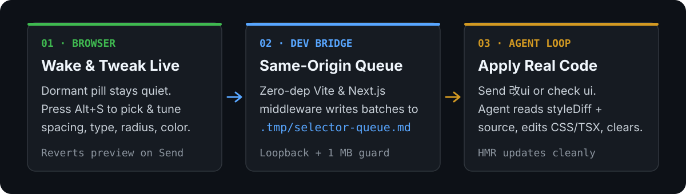

<p align="center">
  
</p>

<p align="center">
  <strong>English</strong> | <a href="./README.zh-CN.md">简体中文</a>
</p>

A dev-server bridge, live CSS tweaker, and self-contained agent skill built on top of **[oil-oil/selector](https://github.com/oil-oil/selector)** — pick elements in your Vite or Next.js app, tune spacing/typography/colors live, and send exact `styleDiff:` batches straight to `.tmp/selector-queue.md`.

<p align="center">
  
</p>

## Why selector-dev

- **Dormant until needed (`Alt+S`)**: Renders only a quiet bottom-right pill during development without adding `data-ai-id` attributes to your DOM until woken.
- **Unified draggable popover**: Combine free-text notes (`instruction:`) and live CSS tweaking (`padding`, `margin`, `gap`, `font-size`, `font-weight`, `border-radius`, `opacity`, `width`, `height`, `color`, `background-color`) in one draggable panel.
- **Clean `styleDiff:` + HMR safety**: Exported context snapshots the underlying DOM before temporary preview overrides (`withCleanTweaks`), and clicking **Send to Workspace** reverts inline preview styles immediately so Vite/Next.js HMR shows your real source changes.
- **Zero-clipboard multi-workspace safety**: Each dev server writes only to `.tmp/selector-queue.md` under its own `process.cwd()`. Switch to that project's agent chat and type `改ui` (or `check ui`).
- **Self-contained Agent Skill (`skills/selector-dev`)**: Ships prebuilt runtime assets, zero-dependency adapters, TypeScript declarations, and auto-detection/injection scripts for Vite and Next.js (App Router & Pages Router).

## Quick start

### Option A — Auto-wire with the bundled Agent Skill

Install or copy `skills/selector-dev` into your agent skills directory (`~/.claude/skills/selector-dev` or `~/.agents/skills/selector-dev`), or run the injector directly against any Vite or Next.js project:

```bash
# 1. Preview detected framework and planned changes
node skills/selector-dev/scripts/inject_selector.mjs --target /path/to/your-app

# 2. Inject self-contained runtime into .tmp/selector-dev/ and wire config/routes
node skills/selector-dev/scripts/inject_selector.mjs --target /path/to/your-app --apply

# 3. Revert cleanly when finished
node skills/selector-dev/scripts/inject_selector.mjs --target /path/to/your-app --revert --apply
```

### Option B — Wire manually in Vite or Next.js

See [docs/usage-dev-bridge.md](./docs/usage-dev-bridge.md) and [skills/selector-dev/references/adapters.md](./skills/selector-dev/references/adapters.md) for copy-paste Vite (`selectorDevPlugin`), Next.js App Router (`createNextAppHandler`), and Next.js Pages Router (`createNextPagesHandler`) snippets.

### Daily workflow

1. Start `vite dev` or `next dev`. Normal page clicks stay untouched while Selector rests in the bottom-right corner.
2. Press `Alt+S` (or click the pill) to wake Selector.
3. Click an element and open the pencil icon to annotate and live-tweak styles.
4. Click **Send to Workspace** (`投递到工作区`).
5. In your AI coding session for that repo, send `改ui` to apply every batch from `.tmp/selector-queue.md` to real source styles and clear the queue.

## Example queue batch

```markdown
<!-- selector-batch: 2026-11-11T05:00:00.000Z -->
## UI Feedback Batch #1 (05:00:00)
- Page: http://localhost:5173/
- Items: 1

````text
Page: http://localhost:5173/
Viewport: 1280x800

Selected Elements:
1. button#hero-btn
   source: src/components/Hero.tsx:42
   selector: button#hero-btn
   styleDiff: padding-top: 8px -> 24px; font-size: 14px -> 18px
   instruction: Match primary CTA height to the section scale
````
```

## Security and verification

- **Same-origin & DNS Rebinding defense**: Rejects `Sec-Fetch-Site: cross-site`, non-loopback `Host` / `Origin` headers, mismatched `Origin`, non-JSON `Content-Type`, and payloads over 1 MB (draining stream before returning HTTP `413`).
- **Dev-only execution**: Vite plugin uses `apply: "serve"`; Next.js handlers return `404` whenever `process.env.NODE_ENV !== "development"`.
- **Bookmarklet compatibility preserved**: `index.html` + `payload-00..07.css` remain intact and `window.__SELECTOR_DEV__` stays isolated from `window.__SELECTOR_HOST__`.

Run the full local suite (build, skill runtime sync, adapter unit tests, headless Chrome CDP E2E, and skill smoke tests):

```bash
npm run check
npm run demo
```

## Upstream attribution

This project builds directly upon **[Selector](https://github.com/oil-oil/selector)** created by **[oil-oil](https://github.com/oil-oil)**. All core bookmarklet selection, locator generation, React source detection, Sharingan capture, and `HOST_CONTRACT` seam architecture come from the upstream repository.

`selector-dev` extends that foundation with dormant `Alt+S` dev-server lifecycle, the unified live CSS tweaker (`styleDiff:`), zero-dependency Vite/Next.js adapters, and the self-contained `skills/selector-dev` workflow.

## License

MIT — see [LICENSE](./LICENSE).
