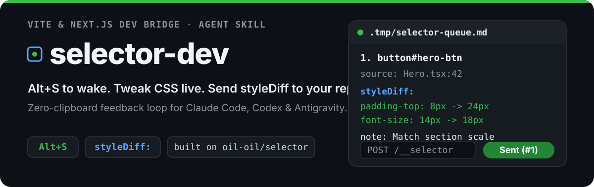
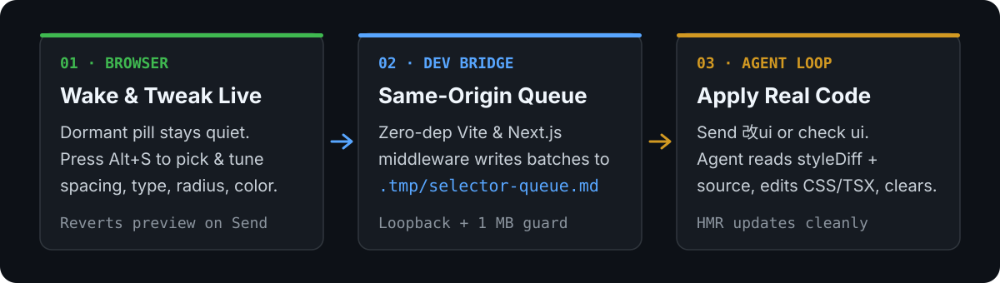

<p align="center">
  
</p>

<p align="center">
  <a href="./README.md">English</a> | <strong>简体中文</strong>
</p>

基于 **[oil-oil/selector](https://github.com/oil-oil/selector)** 扩展的本地开发服务器桥接器、实时 CSS 微调面板与自包含 Agent Skill：在 Vite 或 Next.js 页面中选取任意元素、实时调节间距/字体/配色，并将精确的 `styleDiff:` 批次直接投递到当前项目根目录的 `.tmp/selector-queue.md`。

<p align="center">
  
</p>

## 核心特性

- **默认休眠，热键唤醒（`Alt+S`）**：开发模式下仅在右下角渲染半透明胶囊，未唤醒前不向页面 DOM 注入 `data-ai-id`，日常点击测试零干扰。
- **统一可拖动浮窗**：将文字批注（`instruction:`）与实时样式微调（`padding`、`margin`、`gap`、`font-size`、`font-weight`、`border-radius`、`opacity`、`width`、`height`、`color`、`background-color`）收拢在一个可任意拖动的弹窗中，避免遮挡目标元素。
- **纯净 `styleDiff:` 导出与 HMR 安全回滚**：导出上下文前通过 `withCleanTweaks` 临时恢复原始样式，点击 **投递到工作区（Send to Workspace）** 后立即撤回内联预览样式，防止修改源码触发 Vite/Next.js HMR 时旧内联样式遮盖真实效果。
- **零剪贴板多工作区隔离**：每个 dev server 只会写入自身 `process.cwd()` 下的 `.tmp/selector-queue.md`。切回对应项目的 AI 会话发送 `改ui`（或 `check ui`）即可消费，彻底避免跨仓库、跨会话串线。
- **自包含 Agent Skill（`skills/selector-dev`）**：内聚预编译运行时、零依赖适配器、TypeScript 类型声明（`.d.mts`）以及 Vite / Next.js（App Router 与 Pages Router）自动探测和一键注入脚本。

## 快速开始

### 方式一：使用内置 Agent Skill 一键接入

将 `skills/selector-dev` 复制或软链到你的 Agent 技能目录（如 `~/.claude/skills/selector-dev` 或 `~/.agents/skills/selector-dev`），或直接运行内置注入脚本：

```bash
# 1. 预览目标项目的框架识别结果与拟修改文件（dry-run）
node skills/selector-dev/scripts/inject_selector.mjs --target /path/to/your-app

# 2. 拷贝自包含运行时至 .tmp/selector-dev/ 并自动接线配置与 dev 路由
node skills/selector-dev/scripts/inject_selector.mjs --target /path/to/your-app --apply

# 3. 调试完成后一键干净撤回
node skills/selector-dev/scripts/inject_selector.mjs --target /path/to/your-app --revert --apply
```

### 方式二：手动接入 Vite 或 Next.js

详细的 Vite（`selectorDevPlugin`）、Next.js App Router（`createNextAppHandler`）与 Pages Router（`createNextPagesHandler`）接入示例请参阅 [docs/usage-dev-bridge.md](./docs/usage-dev-bridge.md) 与 [skills/selector-dev/references/adapters.md](./skills/selector-dev/references/adapters.md)。

### 日常工作流

1. 启动 `vite dev` 或 `next dev`。右下角出现半透明 `Selector` 胶囊，正常交互不受任何影响。
2. 按下 `Alt+S`（或点击胶囊）唤醒 Selector。
3. 选中目标元素并点击铅笔按钮，输入修改说明并实时拖动微调样式。
4. 点击 **投递到工作区**（`Send to Workspace`）。
5. 切回该项目对应的 AI 编程会话发送 `改ui`，Agent 会读取 `.tmp/selector-queue.md`，把每一批 `styleDiff` 与 `instruction` 落实到真实源码样式并清空队列。

## 队列输出示例

```markdown
<!-- selector-batch: 2026-11-11T05:00:00.000Z -->
## UI Feedback Batch #1 (05:00:00)
- Page: http://localhost:5173/
- Items: 1

````text
Page: http://localhost:5173/
Viewport: 1280x800

Selected Elements:
1. button#hero-btn
   source: src/components/Hero.tsx:42
   selector: button#hero-btn
   styleDiff: padding-top: 8px -> 24px; font-size: 14px -> 18px
   instruction: Match primary CTA height to the section scale
````
```

## 安全边界与本地验证

- **同源校验与 DNS Rebinding 防护**：中间件拒绝 `Sec-Fetch-Site: cross-site`、非环回 `Host` / `Origin`、主机名不匹配的 `Origin`、非 JSON `Content-Type`，以及超过 1 MB 的请求体（排空流后返回 HTTP `413`）。
- **仅限开发环境生效**：Vite 插件锁定 `apply: "serve"`；Next.js 路由处理器在 `process.env.NODE_ENV !== "development"` 时直接返回 `404`。
- **原版书签完全兼容**：保留 `index.html` 与 `payload-00..07.css` 构建产物，`window.__SELECTOR_DEV__` 与 `window.__SELECTOR_HOST__` 契约完全隔离。

运行完整本地验证套件（构建产物、Skill 运行时同步、适配器单测、无头 Chrome CDP E2E 与 Skill 冒烟测试）：

```bash
npm run check
npm run demo
```

## 原作致谢（Upstream Attribution）

本项目直接构建于 **[oil-oil](https://github.com/oil-oil)** 开源的 **[Selector](https://github.com/oil-oil/selector)** 之上。核心书签选取引擎、定位器生成、React 源码位置识别、写轮眼模式抓取及 `HOST_CONTRACT` 扩展隔离架构均源自上游原仓库。

`selector-dev` 在此基础上扩展了 `Alt+S` 休眠状态机、统一实时 CSS 微调面板（`styleDiff:`）、零依赖 Vite/Next.js 同源桥接中间件，以及自包含的 `skills/selector-dev` 工作流。

## 开源协议

MIT — 详见 [LICENSE](./LICENSE)。
